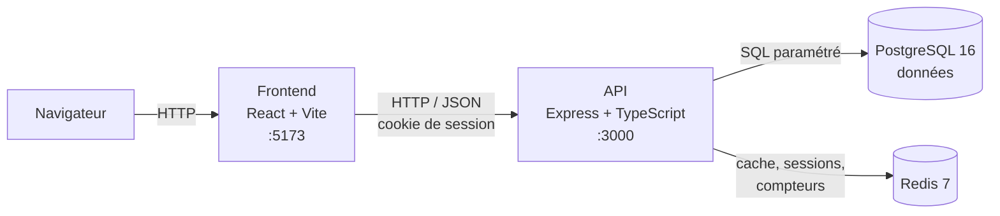

# Portfolio professionnel avec génération de CV

Application web full-stack qui permet à un étudiant de présenter son parcours sur un **portfolio public** et de **générer son CV en PDF** à partir de ses données.

Réalisé par **Eddy Russel Ngoue** dans le cadre du cours *Tendances technologiques*, Collège LaSalle.

**Stack :** React (Vite) · Express · TypeScript · PostgreSQL · Redis · Docker

---

## Sommaire

1. [Fonctionnalités](#fonctionnalités)
2. [Démarrage rapide](#démarrage-rapide)
3. [Architecture](#architecture)
4. [Structure du projet](#structure-du-projet)
5. [Tests et qualité du code](#tests-et-qualité-du-code)
6. [Commandes utiles](#commandes-utiles)
7. [Documentation détaillée](#documentation-détaillée)

---

## Fonctionnalités

### Espace public : le portfolio (`/p/<slug>`)

- Page responsive présentant toutes les sections : profil, parcours, projets, compétences, contact (RF-10).
- Adresse unique et lisible, par exemple `/p/eddy-russel-ngoue` (RF-12).
- Visible seulement si l'étudiant le rend public (RF-11).
- Données servies depuis un **cache Redis**, vidé à chaque modification (RF-13).
- Bouton **« Télécharger mon CV »** si l'étudiant l'autorise.
- Thème sombre « éditeur de code », menu fixe, animations (désactivées si l'utilisateur demande moins d'animations).

### Espace privé : le tableau de bord (`/dashboard`)

| Onglet | Ce qu'on y fait |
|---|---|
| **Profil** | Modifier nom, titre, présentation, ville, téléphone (privé), liens ; rendre le portfolio public ou privé |
| **Expériences, Formations, Compétences, Projets** | Ajouter, modifier, supprimer, réordonner (CRUD complet) |
| **Mon CV** | Générer le CV en PDF : 2 modèles, choix des sections et des éléments, aperçu, téléchargement ; publier un CV pour les visiteurs |
| **Statistiques** | Visites, visiteurs uniques et téléchargements du CV sur 30 jours |
| **Compte** | Changer de mot de passe, supprimer son compte et toutes ses données |

### Génération du CV (cœur du projet)

| Exigence | Réalisation |
|---|---|
| RF-20 PDF à partir de la base | `POST /api/cv/download` lit PostgreSQL et produit le PDF avec **@react-pdf/renderer** |
| RF-21 Au moins 2 modèles | **Classique** (une colonne, Times) et **Moderne** (deux colonnes, couleurs du portfolio) |
| RF-22 Choix du contenu | Cases à cocher par section et par élément |
| RF-23 Aperçu | Aperçu intégré, mis à jour automatiquement |
| RF-24 1 à 2 pages | Mise en page automatique, aucun élément coupé entre deux pages |
| RF-25 Nom du fichier | `CV_Prenom_Nom.pdf` |
| RF-26 Cache Redis | Clé `cv:<utilisateur>:<modèle>:<empreinte des données>`, valable 24 h |

### Sécurité

- Mots de passe hachés avec **bcrypt** (12 tours) ; jamais stockés en clair.
- Sessions stockées dans **Redis** (jeton aléatoire de 256 bits, 7 jours), envoyées dans un cookie `httpOnly`.
- Changement de mot de passe : les autres sessions sont fermées.
- Toutes les entrées sont validées avec **Zod** ; toutes les requêtes SQL sont **paramétrées** (`$1`, `$2`…).
- Chaque requête privée filtre sur `user_id` : un utilisateur ne peut jamais lire ni modifier les données d'un autre.
- En-têtes de sécurité avec **Helmet**, **CORS** limité au frontend.
- Fichiers téléversés : uniquement de vrais PDF (vérification de la signature `%PDF-`), 5 Mo maximum.
- Statistiques anonymes : aucune adresse IP enregistrée.

---

## Démarrage rapide

**Prérequis :** Docker Desktop (et Git).

```bash
git clone https://github.com/EddyRussel/Portfolio.git
cd Portfolio
cp .env.example .env          # puis modifier les mots de passe dans .env
docker compose up --build
```

> Sous Windows (PowerShell), remplacer `cp` par `copy`.

Au premier démarrage, PostgreSQL crée les tables et les données de départ (`backend/db/init.sql`), puis l'API applique automatiquement les migrations (`backend/src/migrate.ts`).

| Service | Adresse |
|---|---|
| Frontend | http://localhost:5173 |
| Portfolio de démonstration | http://localhost:5173/p/eddy-russel-ngoue |
| API (santé) | http://localhost:3000/api/health |
| PostgreSQL | localhost:5432 |
| Redis | localhost:6379 |

### Se connecter au compte de départ

Le compte créé par `init.sql` a un mot de passe factice. Pour lui en donner un :

```bash
docker compose exec backend npx tsx src/scripts/setPassword.ts ngouerussel@gmail.com "UnMotDePasse"
```

Puis se connecter sur http://localhost:5173/login. On peut aussi simplement créer un nouveau compte sur `/register`.

### Variables d'environnement (`.env`)

| Variable | Rôle |
|---|---|
| `POSTGRES_USER`, `POSTGRES_PASSWORD`, `POSTGRES_DB` | Identifiants de la base PostgreSQL |
| `CORS_ORIGIN` | Adresse du frontend autorisée à appeler l'API |
| `STATS_TIMEZONE` *(facultatif)* | Fuseau horaire des statistiques (défaut : `America/Toronto`) |

Le fichier `.env` n'est **jamais** envoyé sur GitHub (voir `.gitignore`).

---

## Architecture



Les quatre services tournent dans des conteneurs Docker, orchestrés par `docker-compose.yml`.

| Rôle de Redis | Clés |
|---|---|
| Sessions | `session:<jeton>`, `user-sessions:<id>` |
| Cache du portfolio public | `portfolio:<slug>` (5 min) |
| Cache des CV générés | `cv:<id>:<modèle>:<empreinte>` (24 h) |
| Compteurs de visites | `stats:pending`, `stats:seen:*`, `stats:uv:*` (HyperLogLog) |

Les choix techniques sont justifiés dans [`docs/CHOIX-TECHNIQUES.md`](docs/CHOIX-TECHNIQUES.md).

---

## Structure du projet

```
.
├── docker-compose.yml
├── .env.example
├── docs/                         # documentation détaillée
├── backend/
│   ├── db/init.sql               # tables + données de départ
│   ├── src/
│   │   ├── index.ts              # démarrage (Redis, migrations, serveur)
│   │   ├── app.ts                # application Express (routes, sécurité, erreurs)
│   │   ├── migrate.ts            # migrations appliquées au démarrage
│   │   ├── session.ts            # sessions dans Redis
│   │   ├── cache.ts              # invalidation du cache du portfolio
│   │   ├── visitStats.ts         # statistiques (Redis -> PostgreSQL)
│   │   ├── validation.ts         # règles Zod partagées
│   │   ├── middleware/requireAuth.ts
│   │   ├── routes/               # une route par fichier (auth, crud, cv…)
│   │   ├── cv/                   # génération du CV (service + 2 modèles)
│   │   └── scripts/setPassword.ts
│   └── tests/                    # tests Vitest + Supertest
└── frontend/
    └── src/
        ├── PublicPortfolio.tsx   # le portfolio public
        ├── pages/                # Login, Register, Dashboard
        ├── dashboard/            # éditeurs, CV, statistiques, compte
        ├── auth.tsx              # contexte de connexion
        └── api.ts                # appels à l'API
```

---

## Tests et qualité du code

```bash
docker compose exec backend npm test        # 24 tests (Vitest + Supertest)
docker compose exec backend npm run lint    # ESLint
docker compose exec frontend npm run lint
docker compose exec backend npm run format  # Prettier
docker compose exec frontend npm run format
```

Les tests couvrent l'authentification, le CRUD, l'isolation entre utilisateurs, le cache Redis, la génération du PDF et les statistiques. Ils créent des comptes temporaires (`@test.local`) supprimés à la fin : les vraies données ne sont jamais touchées.

TypeScript est en mode strict dans les deux projets.

---

## Commandes utiles

```bash
docker compose up --build                   # tout démarrer (après un changement de dépendances)
docker compose down                         # tout arrêter
docker compose down -v                      # tout arrêter ET effacer la base (réinitialisation)
docker compose logs -f backend              # suivre les messages de l'API
docker compose exec postgres psql -U portfolio -d portfolio
docker compose exec redis redis-cli
```

**En cas de souci avec Docker** (après un disque plein ou un plantage) :

```bash
docker compose down -v
docker compose build --no-cache
docker compose up
```

---

## Documentation détaillée

- [`docs/API.md`](docs/API.md) : toutes les routes de l'API
- [`docs/BASE-DE-DONNEES.md`](docs/BASE-DE-DONNEES.md) : schéma et diagramme entité-relation
- [`docs/CHOIX-TECHNIQUES.md`](docs/CHOIX-TECHNIQUES.md) : choix techniques justifiés
