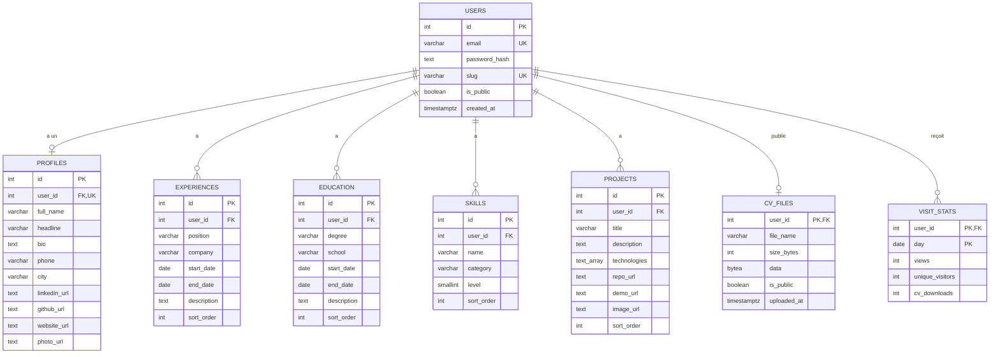

# Base de données

PostgreSQL 16. Les tables sont créées par `backend/db/init.sql` (première création de la base) et par les migrations de `backend/src/migrate.ts` (appliquées à chaque démarrage de l'API, sans risque grâce à `IF NOT EXISTS`).

## Diagramme entité-relation

`||--o|` = un utilisateur a **zéro ou un** élément ; `||--o{` = **zéro ou plusieurs**.

Le même diagramme en image (pour un document imprimé) : [`diagramme-entite-relation.png`](diagramme-entite-relation.png).

## Les tables

| Table | Contenu | Clé |
|---|---|---|
| `users` | Comptes : courriel, hachage bcrypt du mot de passe, slug, visibilité | `id` |
| `profiles` | Informations de présentation (une ligne par utilisateur) | `id`, `user_id` unique |
| `experiences` | Expériences professionnelles et bénévolat | `id` |
| `education` | Formations et certifications | `id` |
| `skills` | Compétences et langues (`level` de 1 à 5) | `id` |
| `projects` | Projets (`technologies` = tableau de textes) | `id` |
| `cv_files` | CV PDF téléversé (données binaires `BYTEA`), un par utilisateur | `user_id` |
| `visit_stats` | Statistiques par portfolio et par jour, recopiées depuis Redis chaque minute | (`user_id`, `day`) |

## Règles importantes

- **`ON DELETE CASCADE`** sur toutes les clés étrangères : supprimer un utilisateur supprime automatiquement toutes ses données (RF-04).
- **`sort_order`** : ordre d'affichage choisi par l'utilisateur ; modifié par `PUT /api/<ressource>/reorder`.
- **Dates** : stockées en `DATE` (le 1er du mois), échangées avec l'API au format `AAAA-MM`. `end_date` à `NULL` = en cours.
- **Contraintes** : `email` et `slug` uniques ; `level` entre 1 et 5 (`CHECK`).
- Le **téléphone** n'est jamais renvoyé par les routes publiques.

## Pourquoi stocker le CV dans PostgreSQL ?

Le PDF est stocké dans une colonne `BYTEA` plutôt que dans un dossier du serveur : il est sauvegardé avec le reste des données, il survit aux redémarrages des conteneurs, et il fonctionne sur les hébergeurs dont le disque est effacé à chaque déploiement. Les fichiers sont petits (5 Mo maximum), ce qui rend cette approche raisonnable.
